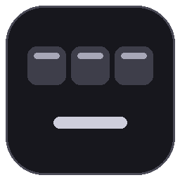
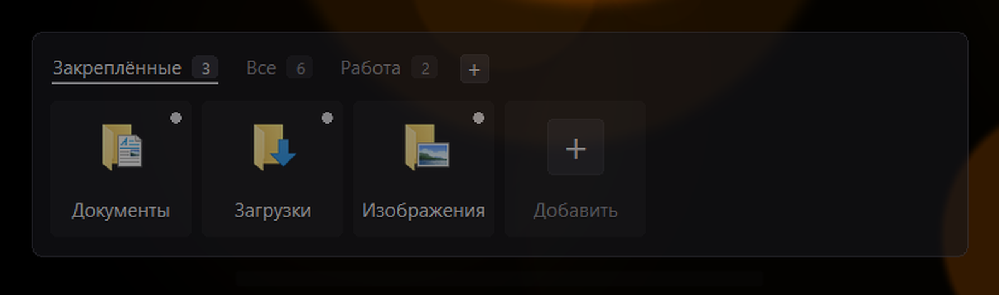
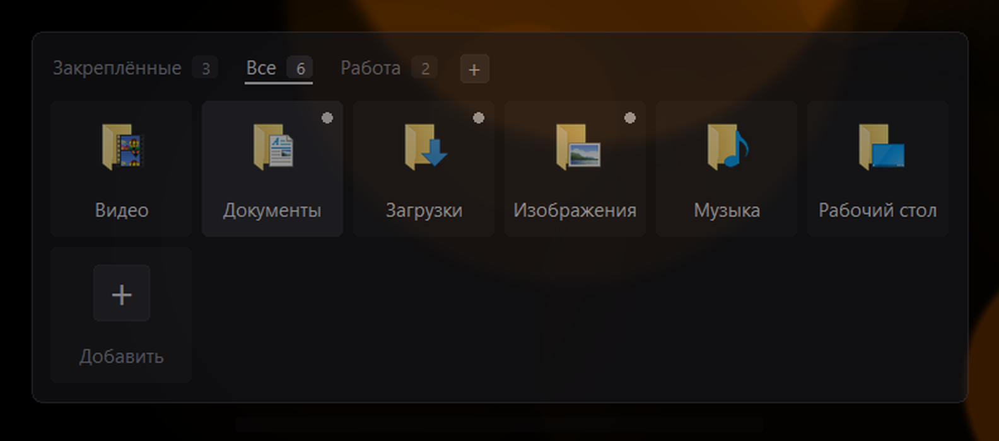
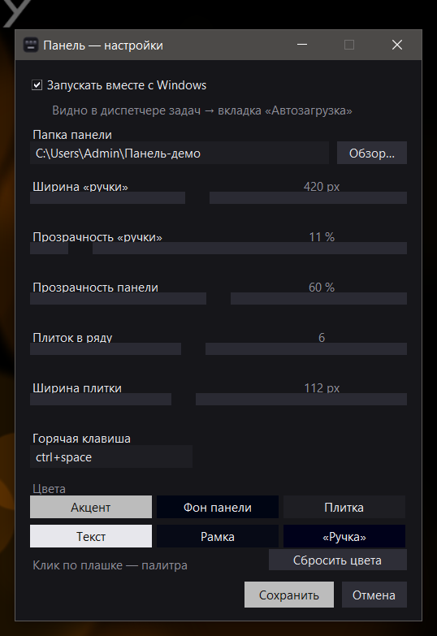
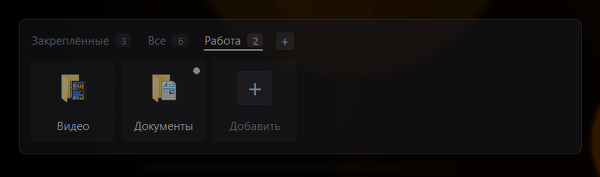

<p align="center">
  
</p>

<h1 align="center">Панель</h1>

<p align="center">Быстрый доступ к папкам и ярлыкам — прямо с рабочего стола Windows.<br>
Невидимая «ручка» внизу экрана, по клику выезжает аккуратная панель с ярлыками.</p>

<p align="center">
  
  
  
  
</p>

---

## Что это

Панель — это док, который живёт **на уровне рабочего стола**, а не поверх окон. Внизу по центру есть еле заметная полупрозрачная «ручка»: кликнул — выехала панель с ярлыками папок и программ. Ещё раз кликнул или нажал мимо — уехала.

Главное отличие от обычных доков: панель **не мешает работать**. Любое приложение её перекрывает — если окно развернуто на весь экран, ручки просто не видно. При этом если хоть кусочек торчит — клик по нему открывает панель.

<p align="center">
  
</p>

## Возможности

- **Невидимая «ручка»** — 420 px шириной, 10 % непрозрачности, без ярких элементов. Стоит вплотную к панели задач и не висит над окнами программ.
- **Вкладки «Закреплённые» / «Все»** — счётчики в бейджах. Если закреплённые есть, панель открывается на них; иначе показывает всё.
- **Свои группы** — «+» справа от вкладок создаёт группу («Работа», «Учёба»…). Правый клик по вкладке — переименовать или удалить; правый клик по плитке → «Добавить в группу». Один ярлык может быть в нескольких группах.
- **Закрепление** — правый клик по плитке → «Закрепить». Закреплённые помечаются точкой.
- **Перетаскивание** — зажал плитку, потянул, бросил на другую: она встанет на её место. Порядок сохраняется.
- **Правый клик по плитке** — открыть, показать в проводнике, закрепить/открепить, убрать с панели (в корзину, восстановить можно).
- **Прокрутка колесом** — видно до 4 рядов, дальше скролл.
- **Управление с клавиатуры** — `A`/`D` листают вкладки, `E` опускает к плиткам, `W`/`A`/`S`/`D` водят по сетке, `E` открывает выбранное, `Q` возвращает к вкладкам. Понимает и русскую раскладку (Ф/В/Ц/Ы/У/Й), и стрелки.
- **Настройки в отдельном окне** — папка, ширина и прозрачность «ручки», прозрачность панели, количество плиток в ряду, размер плитки, горячая клавиша и **6 настраиваемых цветов** с кнопкой «Сбросить цвета».
- **Иконка в трее** — правый клик: открыть панель, настройки, папка панели, автозапуск, выход.
- **Автозапуск с Windows** — переключается в настройках, меню или в диспетчере задач. Состояние везде синхронизировано.
- **Горячая клавиша** — по умолчанию `Ctrl+Alt+Space`, работает даже когда всё развёрнуто на весь экран.
- **Никаких зависимостей**, кроме Pillow. Один файл `.pyw`, настройки в JSON.

## Скриншоты

<table>
<tr>
<td width="50%">
<br>
<sub>Вкладка «Все»: все ярлыки, закреплённые помечены точкой</sub>
</td>
<td width="50%">
<br>
<sub>Окно настроек: размеры, прозрачность, цвета</sub>
</td>
</tr>
</table>

## Группы

Свои подборки ярлыков: «Работа», «Учёба», «Игры» — что угодно. Создаются кнопкой **«+»** справа от вкладок.

<p align="center">
  
</p>

- **Создать** — «+» → ввести название.
- **Положить ярлык** — правый клик по плитке → «Добавить в группу» → выбрать группу. Галочка ✓ показывает, что ярлык уже там (повторный клик убирает). В этом же меню есть «Новая группа…».
- **Переименовать / удалить** — правый клик по вкладке группы.
- Группы ничего не копируют: это подборки из той же папки панели, один ярлык может быть в нескольких группах.

## Быстрый старт

1. Установите Python 3.10+ и Pillow:

   ```bash
   pip install pillow
   ```

2. Скопируйте папку с проектом куда угодно (например, `%LOCALAPPDATA%\DesktopPanel`).

3. Запустите:

   ```bash
   pythonw panel.pyw
   ```

   Внизу по центру появится «ручка». Первый запуск создаст рядом `config.json` и `state.json`.

4. Положите ярлыки в папку панели (по умолчанию `%USERPROFILE%\Панель`) или нажмите плитку **«Добавить»** — откроется эта папка. Панель перечитывает её при каждом открытии.

### Сборка Panel.exe (необязательно)

Если хочется, чтобы в диспетчере задач и автозагрузке приложение называлось «Панель», а не «Python»:

```bash
build_exe.bat
```

Скрипт собирает маленький лаунчер `Panel.exe` из `Launcher.cs` встроенным компилятором .NET Framework (`csc.exe`, есть в Windows из коробки) и подшивает иконку `app.ico`.

## Как пользоваться

| Действие | Что делает |
|---|---|
| Клик по «ручке» | открыть / закрыть панель |
| `Ctrl+Alt+Space` | открыть / закрыть панель |
| `A` / `D` | переключить вкладку «Закреплённые» ↔ «Все» |
| `E` | спуститься к плиткам / открыть выбранную |
| `W` `A` `S` `D` | двигаться по плиткам |
| `Q` | вернуться от плиток к вкладкам |
| Клик по плитке | открыть папку или программу |
| Правый клик по плитке | меню ярлыка, в том числе «Добавить в группу» |
| «+» справа от вкладок | создать свою группу |
| Правый клик по вкладке группы | переименовать / удалить группу |
| Перетащить плитку | изменить порядок |
| Клик мимо / `Esc` | закрыть панель |
| Колесо мыши | прокрутка при большом числе ярлыков |
| Правый клик по «ручке» | меню панели: настройки, папка, автозапуск, выход |

## Настройки

Всё меняется в окне настроек (правый клик по «ручке» → **Настройки…**). Для тонкой настройки есть `config.json` рядом с программой:

| Ключ | По умолчанию | Описание |
|---|---|---|
| `folder` | `%USERPROFILE%\Панель` | папка, содержимое которой показывается |
| `columns` | `6` | плиток в ряду |
| `tile_width` / `tile_height` | `112` / `108` | размер плитки |
| `max_rows` | `4` | сколько рядов видно (дальше — прокрутка) |
| `hotkey` | `ctrl+alt+space` | глобальная горячая клавиша |
| `trigger_width` / `trigger_height` | `420` / `14` | размер «ручки» |
| `trigger_alpha` / `trigger_alpha_hover` | `0.10` / `0.45` | прозрачность «ручки» |
| `panel_alpha` | `0.97` | прозрачность панели (в настройках 20–100 %) |
| `accent` | `#D8D8E0` | акцент: плюс, подчёркивание вкладки, метки |
| `panel_color` / `tile_color` / `border_color` | тёмные | цвета панели и плиток |
| `text_color` / `text_dim` | светлые | цвет текста |
| `trigger_fill` | `#1B1B21` | цвет «ручки» |

Порядок плиток и закреплённые хранятся отдельно — в `state.json`.

## Как это устроено

Всё на стандартной библиотеке + Pillow, без сторонних фреймворков:

- **Окна** — `tkinter` Toplevel без рамки (`overrideredirect`) с `-transparentcolor` для скруглённых углов и `-alpha` для прозрачности.
- **«Ручка» не поверх окон** — окно не делается topmost, а ставится в Z-порядке сразу над рабочим столом (`Progman`/`WorkerW` через `SetWindowPos`), с `WS_EX_NOACTIVATE | WS_EX_TOOLWINDOW`. Поэтому приложения её перекрывают, а клик не забирает фокус.
- **Иконки** — `SHGetImageList(SHIL_EXTRALARGE)` + `DrawIconEx` в DIB-секцию, результат кэшируется PNG-файлами (старые чистятся автоматически).
- **Панель задач** — свой `AppUserModelID` у процесса + `WM_SETICON`, поэтому в диспетчере задач видно иконку и имя «Панель», а не Python.
- **Автозапуск** — значение в `HKCU\...\Run`; состояние читается из `StartupApproved\Run`, поэтому галочка в настройках и переключатель в диспетчере задач не расходятся.
- **Один экземпляр** — именованный мьютекс; **DPI** — `SetProcessDpiAwareness` + масштаб Tk.
- **Ресурсы** — в простое 0 % CPU (цикл опроса замедляется, когда всё закрыто), ~37 МБ памяти, запуск ~0.4 с.

## Структура проекта

```
desktop-panel/
├── panel.pyw              # вся программа
├── Launcher.cs            # исходник Panel.exe (имя и иконка в системе)
├── app.ico                # иконка приложения
├── build_exe.bat          # сборка Panel.exe через csc.exe
├── requirements.txt
├── README.md
├── LICENSE
└── docs/
    ├── icon.png
    └── screenshots/
        ├── panel-pinned.png
        ├── panel-all.png
        └── settings.png
```

## Ограничения

- Только **Windows 10/11** (используется Win32 API и layered-окна).
- Перетащить файл из проводника прямо на панель нельзя — добавление через папку панели (кнопка «Добавить»).
- Мультимониторность: панель появляется на основном экране.

## Лицензия

MIT — делайте что хотите, только сохраните текст лицензии.
